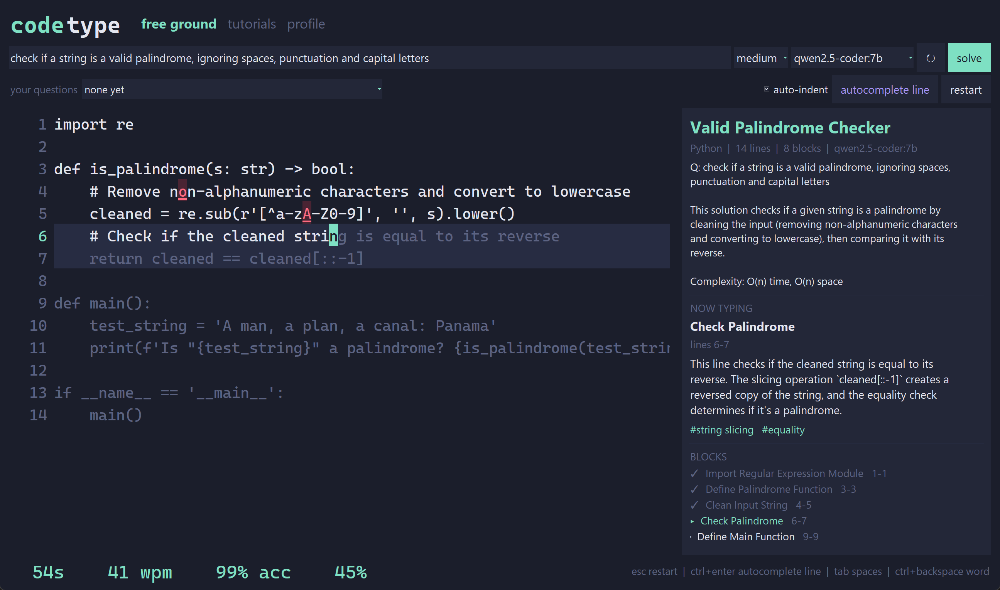
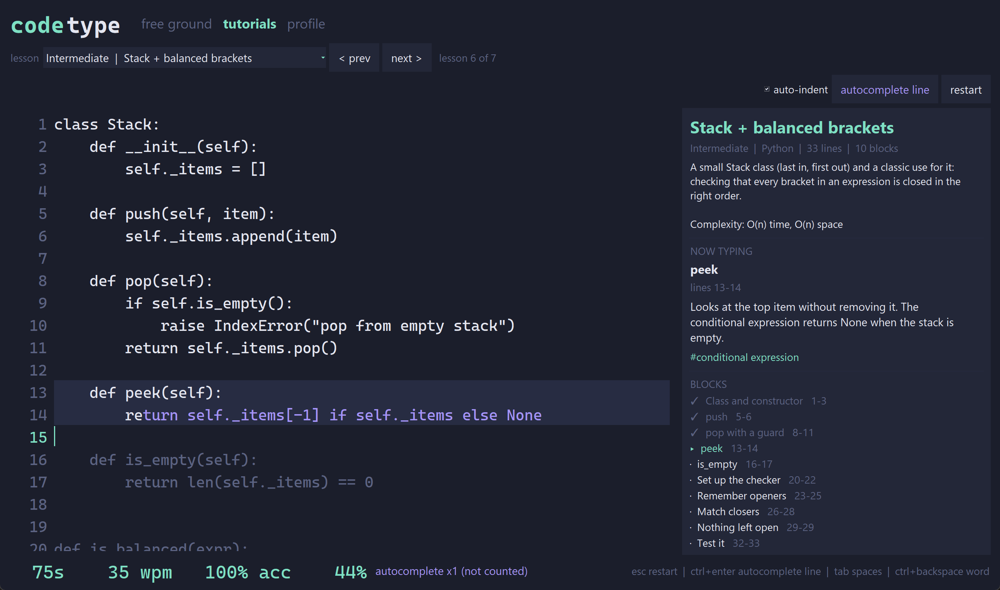
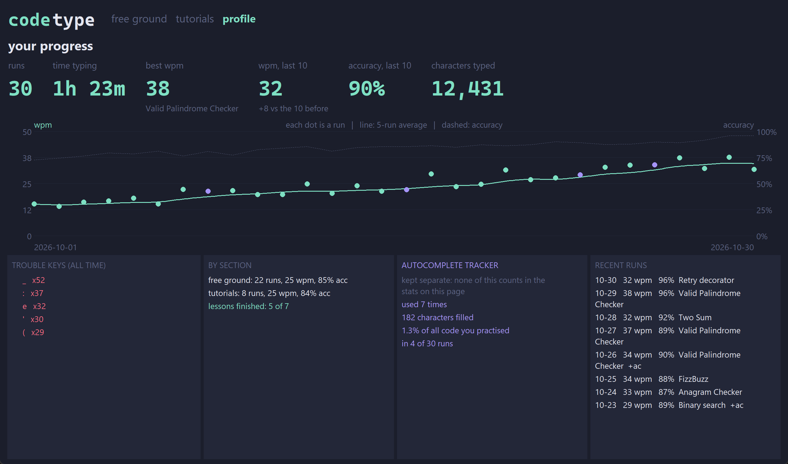

# codetype

Learn Python by typing it. Ask any coding question, and a local AI model answers with
Python code that you **type along**, character by character, while a side panel explains the
block you're on. WPM and accuracy are tracked so you can see yourself improve.



## Features

- **Free ground**: ask any coding question. A local model (through [Ollama](https://ollama.com))
  answers with Python code, an overview of the approach, its time/space complexity, and an
  explanation for every block. Answers are checked for syntax errors before you see them, and
  your questions are saved so you can practise them again.
- **Tutorials**: 7 hand-written lessons from Beginner to Advanced (FizzBuzz, list comprehensions,
  binary search, memoization, a stack, a retry decorator and more).
- **Profile**: your progress over time: wpm and accuracy per run with a moving average,
  best and recent averages, trouble keys, free ground vs tutorials, and recent runs.
- **Autocomplete line** (Ctrl+Enter) for when you're tired. Autocompleted characters show in
  purple and **never count towards wpm or accuracy**; they go in a separate tracker.
- After every run: wpm, accuracy, a speed graph, the keys you missed and the blocks that
  slowed you down.
- Everything runs on your own computer, with no account or API key. Pure Python with nothing
  to `pip install`.

| Tutorials | Profile |
|---|---|
|  |  |

## Getting started

You need **Python 3.10 or newer**, **git**, and **Ollama** (only for free ground; tutorials work
without it).

### 1. Get the code

```bash
git clone https://github.com/saahir23/codetype.git
cd codetype
```

Or download the ZIP from the green **Code** button on GitHub and unzip it.

### 2. Check Python

```bash
python --version
```

If that fails, install Python from [python.org](https://www.python.org/downloads/). On Windows,
tick **"Add python.exe to PATH"** in the installer. On macOS/Linux you may need `python3`
instead of `python` in the commands below.

The app uses tkinter, which comes with Python on Windows and macOS. On Linux, install it
with your package manager, e.g. `sudo apt install python3-tk` on Ubuntu/Debian.

### 3. Install Ollama and a coding model

1. Download and install Ollama from [ollama.com/download](https://ollama.com/download), then
   open it (it runs in the background).
2. Download a coding model (about 4.7 GB):

   ```bash
   ollama pull qwen2.5-coder:7b
   ```

| Model | Download | Best for |
|---|---|---|
| `qwen2.5-coder:7b` | 4.7 GB | **Recommended.** Computers with 16 GB RAM, ideally a GPU with 8 GB. |
| `qwen2.5-coder:3b` | 1.9 GB | Older or low-memory computers. Faster but weaker answers. |
| `qwen2.5-coder:14b` | 9 GB | Powerful computers (GPU with 12 GB+). Better answers. |

Any installed model will appear in the app, coding models first. General-purpose models
such as `mistral` often write broken code.

### 4. Run it

```bash
python main.py
```

Ask a question in **free ground** and press **solve**. Answers take about 15-60 seconds,
depending on your computer.

## Controls

| Key | What it does |
|---|---|
| typing | Correct characters turn white. Wrong ones turn red; keep going or fix them. |
| Enter | Only accepted at the end of a line. With **auto-indent** on, indentation is skipped for you. |
| Ctrl+Enter | Autocomplete the rest of the line (tracked separately, not counted in stats). |
| Tab | Fills spaces up to the next indent stop (useful with auto-indent off). |
| Backspace / Ctrl+Backspace | Delete a character / a word. |
| Esc | Restart the current code. |

## Troubleshooting

| Problem | Fix |
|---|---|
| "Ollama not running" | Open the Ollama app, then press the ↻ button next to the model list. |
| "no models installed" | Run `ollama pull qwen2.5-coder:7b`, then press ↻. |
| Answers are slow | Try a shorter length or `qwen2.5-coder:3b`. The first answer is slower while the model loads. |
| `No module named tkinter` (Linux) | `sudo apt install python3-tk` (or your distro's equivalent). |
| Ollama runs on another machine/port | Set `OLLAMA_HOST`, e.g. `OLLAMA_HOST=http://192.168.1.20:11434`. |

## Your data

Runs and saved questions are stored in the `data/` folder next to the code
(`data/history.json` and `data/questions.json`). Nothing is sent anywhere; Ollama runs locally.
Delete the folder to reset your profile.

## Project structure

| File | Purpose |
|---|---|
| `main.py` | Entry point |
| `ui.py` | tkinter window: free ground, tutorials, profile, results screen |
| `engine.py` | Typing logic and stats, with no UI code (easy to test) |
| `generator.py` | Asks Ollama for a Python answer plus explained blocks, checks it compiles, and lines the blocks up with the code |
| `samples.py` | The tutorial lessons |
| `history.py` | Saves runs and questions, and computes the profile stats |
| `models.py` | `Snippet` and `Section` data classes |
